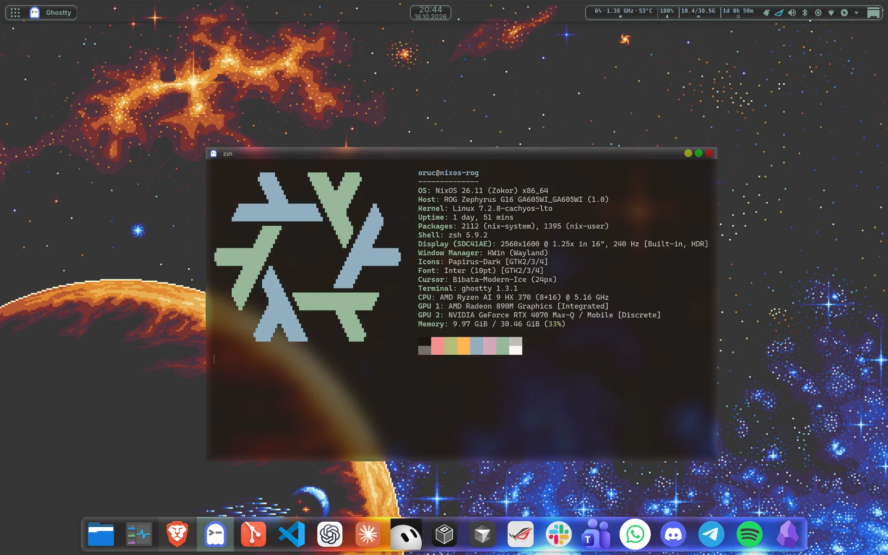
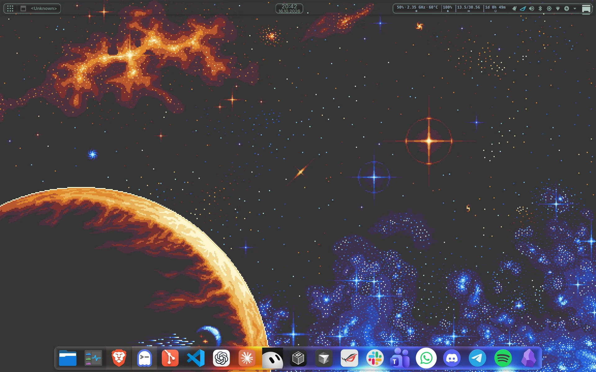

<div align="center">


# nixos-config

**A NixOS desktop, two NixOS laptops and a server in one flake, deployed over Tailscale,<br>
with a CachyOS kernel that GitHub compiles so the hosts never do.**

This is my own setup, not a framework. Read it and copy the parts you need.

[](https://github.com/NixOS/nixpkgs/tree/nixos-unstable)
[](https://github.com/OmerFarukOruc/nixos-config/actions/workflows/kernel-cache.yml)
[](https://omerfarukoruc.cachix.org)

[Hosts](#hosts) · [Stack](#stack) · [Highlights](#highlights) · [Layout](#layout) · [Everyday commands](#everyday-commands) · [Docs](#docs) · [Built on](#built-on)



<sub>nixos-rog · KDE Plasma with the Glass look · Ghostty · Warm Burnout Dark from Base16</sub>

</div>

<details>
<summary>Bare desktop</summary>
<br>

</details>

## Hosts

| Host | Role | Machine | Login sessions | Kernel | Boot |
| --- | --- | --- | --- | --- | --- |
| `nixos-rog` | daily laptop | ASUS ROG Zephyrus G16 GA605WI, Ryzen AI 9 HX 370, RTX 4070 | Plasma · niri + Noctalia · niri + DMS | CachyOS LTO `zen4` | Limine, next to Windows |
| `nixos-desktop` | home desktop | MSI MAG B650 Tomahawk WiFi, Ryzen 7 7800X3D, RX 7900 XTX | Plasma | CachyOS LTO `zen4` | Limine, next to Windows |
| `nixos-latitude` | home lab box | Dell Latitude 3550 | niri + Noctalia | CachyOS LTO `x86_64-v3` | systemd-boot |
| `risoluto-dev-1` | dev server | netcup KVM guest, 2 TiB virtio disk | none | nixpkgs | Limine, BIOS (UEFI unverified) |

`machines/inventory.nix` is the source of truth for this table.

## Stack

| Part | Choice |
| --- | --- |
| Kernel | CachyOS LTO from [nix-cachyos-kernel](https://github.com/xddxdd/nix-cachyos-kernel), built on GitHub |
| Boot loader | Limine on nixos-rog, nixos-desktop and risoluto-dev-1, systemd-boot on nixos-latitude |
| Login screen | SDDM with sddm-astronaut's Jake the dog theme |
| Desktops | KDE Plasma 6, and niri with Noctalia or DankMaterialShell |
| Plasma looks | Glass and Klassy on nixos-rog and nixos-desktop, switched with `plasma-look` |
| Launcher | Rofi and the macOS Tahoe launcher on nixos-rog, Vicinae on nixos-latitude |
| Terminal | Ghostty |
| Login shell | zsh with oh-my-zsh and Starship |
| Editors | VS Code, and Neovim through nvf |
| Theme | Base16 through base16.nix, `warm-burnout-dark` by default, switched with `theme` |
| Secrets | sops-nix with age on nixos-desktop, nixos-rog and risoluto-dev-1 |
| DNS | NextDNS over TLS and Tailscale MagicDNS on nixos-desktop and nixos-rog |
| DPI bypass | zapret2 for Discord, and Cloudflare WARP launchers for Discord and Brave as its fallback, on nixos-desktop and nixos-rog |
| Remote access | Tailscale, and Sunshine on nixos-desktop and nixos-rog; on risoluto-dev-1 an XFCE desktop through xrdp, which the workstations reach with Remmina |
| Binary cache | the `omerfarukoruc` Cachix cache and `cache.numtide.com` |

## Highlights

- **🧊 A kernel the hosts download.** The [`kernel-cache`](kernel-cache/README.md)
  flake builds the CachyOS LTO kernel, the NVIDIA open module, ryzen-smu,
  turbostat and nct6687d on GitHub Actions and pushes them to the `omerfarukoruc` Cachix
  cache. [`scripts/update-kernel.sh`](scripts/update-kernel.sh) moves a host
  only to a revision whose every path is already in that cache.
- **🪟 Three login sessions, one theme.** nixos-rog offers Plasma, niri with Noctalia
  and niri with DankMaterialShell at the login screen. One Base16 scheme sets the
  colors, cursor, icons and wallpaper of all of them. The login screen and the
  Plasma lock screen play Jake the dog, and the login form takes the scheme's colors.
  [`nixosModules/theme.nix`](nixosModules/theme.nix),
  [`home-manager/modules/theme.nix`](home-manager/modules/theme.nix)
- **🎨 Schemes and Plasma looks without a rebuild.** `theme catppuccin-mocha`
  switches the Base16 scheme and `plasma-look klassy` switches the Plasma look
  at run time. Every pair of look and scheme other than the default is a Home
  Manager specialisation of the same generation, and the choice stays across
  deploys. The login screen, boot menu, console and niri keep the machine's
  default scheme. A look sets the
  Plasma style, window decoration, Qt style and KWin effects that belong
  together; Glass and Klassy are the two looks.
  [`machines/variants.nix`](machines/variants.nix),
  [`nixosModules/hm-variants.nix`](nixosModules/hm-variants.nix),
  [`home-manager/modules/plasma-looks/`](home-manager/modules/plasma-looks)
- **🔥 One scheme for the editors too.** Every host starts on `warm-burnout-dark`,
  a Base16 scheme in [`assets/schemes`](assets/schemes). A `warm-burnout-*`
  scheme also installs Warm Burnout's own VS Code and Neovim themes, which color
  syntax beyond the 16 Base16 colors.
  [`home-manager/modules/theme.nix`](home-manager/modules/theme.nix)
- **🍎 A macOS Tahoe dock on an OLED screen.** Plasma takes its launcher and dock
  from the macOS Tahoe theme, with hover zoom and notification badges. To keep
  the top bar and the dock from burning in, the theme's pixel shift moves each
  panel by 2 px every 5 minutes, up to 8 px each way and back.
  [`home-manager/modules/plasma-panels.nix`](home-manager/modules/plasma-panels.nix),
  [`machines/nixos-rog/oled-care.nix`](machines/nixos-rog/oled-care.nix)
- **🛟 Deploys that roll themselves back.** `deploy.sh` builds on the target,
  activates under a 420 second rollback timer, then checks SSH, Tailscale and
  the user's running services. A deploy that breaks any of them restores the
  previous system, even when the connection drops.
  [`deploy.sh`](deploy.sh)
- **🔄 Updates checked on GitHub.** Every 6 hours a GitHub workflow moves the
  inputs and apps, waits for the caches to hold the kernel and the coding
  agents, builds every host, runs the checks and merges the result to `main`.
  Every 2 hours on AC power, nixos-rog deploys the newest `main` to itself.
  [`.github/workflows/update.yml`](.github/workflows/update.yml),
  [`machines/nixos-rog/auto-update.nix`](machines/nixos-rog/auto-update.nix),
  [`scripts/pull-main.sh`](scripts/pull-main.sh)
- **🔐 Secrets bound to the machine.** sops-nix decrypts `secrets/<host>.yaml`
  with the age key derived from that host's SSH host key.
  [`machines/nixos-rog/configuration.nix`](machines/nixos-rog/configuration.nix)
- **🧭 Private DNS on nixos-rog.** Public names go only to NextDNS over TLS and
  tailnet names go to Tailscale's MagicDNS. A `captive-dns` switch handles Wi-Fi
  sign-in pages.
  [`nixosModules/nextdns.nix`](nixosModules/nextdns.nix)

## Layout

```text
flake.nix              inputs; machines/inventory.nix builds the host configurations
machines/              the typed machine inventory and one folder per host
nixosModules/          shared NixOS policy: kernel, boot, desktop, login, theme, ...
home-manager/          the user layer, with one module per shell and app
niri/                  niri config shared by every niri session, with one file per shell
pkgs/  overlays/       apps that nixpkgs lacks, and fixes to nixpkgs packages
kernel-cache/          the separate flake that GitHub builds into Cachix
ci/                    the checks of the git hooks: lock, format and flake checks, unit ordering check, host builds
.github/               the kernel-cache workflow
devenv.nix             the dev shell, its linters and the git hooks
scripts/               checks and builds, scripts that act on nixos-rog, update scripts, the deploy unit and the post-deploy check
tooling.nix            the formatter (nix fmt) and its linters
deploy.sh              the deploy with build, confirm and rollback
secrets/  .sops.yaml   sops-encrypted values and their recipients
docs/                  operating guides and the architecture
assets/                screenshots and wallpapers
AGENTS.md  CONTEXT.md  agent rules; domain terms and SSH aliases
```

[docs/architecture.md](docs/architecture.md) explains how the inventory, the
login sessions, the theme and Home Manager connect.

## Everyday commands

Run these from nixos-desktop or nixos-rog. `deploy.sh` builds on the target.
The other scripts that run Nix run it on the host you run them on, and the
`*-on-rog.sh`, `*-nixos-rog.sh` and `thermal-test-rog.sh` scripts act on
nixos-rog and need it online. `move-inputs.sh`
and `update-release-tags.sh` run `nix flake update`, and `update-app.sh` runs
`nix hash convert` for Claude Desktop, ChatGPT and Grok Bot, so run them in a
checkout with Nix. The update workflow runs them.

| Command | What it does |
| --- | --- |
| `./deploy.sh nixos-rog` | build, activate, confirm and make it the boot default |
| `./deploy.sh nixos-rog test` | activate until the next reboot only |
| `upgrade [--replace]` (on any host) | deploy the newest `main` to this host; on nixos-rog run the deploy unit now; `--replace`, on every other host, passes `--replace` to `deploy.sh`, for a rerun after exit 78 |
| `scripts/update-kernel.sh` | move the kernel to the newest cached build |
| `devenv test` | run the pre-push checks, `ci/checks.sh` and `ci/unit-cycles.sh`, without a push |
| `devenv tasks run ci` | run those checks and build every host's system with `ci/build-hosts.sh` |
| `scripts/check.sh` | run `ci/checks.sh`, the formatter, lock and flake checks, on a copy of the checkout and list each distinct evaluation warning; `--fix` formats |

<details>
<summary>More commands</summary>

| Command | What it does |
| --- | --- |
| `./deploy.sh nixos-rog boot` | set the boot default without activating |
| `./deploy.sh nixos-rog prune` | delete old release copies, keeping the five newest and any the host runs or boots |
| `scripts/eval.sh [--json] [--abort-on-warn] ATTRIBUTE` | print one value of nixos-rog's configuration, or of any flake attribute when it holds `#`; a value that is not a string needs `--json`, and `--abort-on-warn` stops at the first evaluation warning with its stack trace |
| `scripts/build.sh [ATTRIBUTE...]` | build from a copy of the checkout and print each output path; with no ATTRIBUTE, build nixos-rog's system; `.#checks.x86_64-linux.risoluto-dev-1-boot-bios` runs risoluto-dev-1's [boot test](docs/risoluto-dev-1.md#boot-test-in-a-vm), `.#checks.x86_64-linux.risoluto-dev-1-units` its [unit check](docs/risoluto-dev-1.md#unit-check-in-a-vm), `.#checks.x86_64-linux.risoluto-dev-1-self-deploy` its [deploy test](docs/risoluto-dev-1.md#deploy-test-in-a-vm), and `.#checks.x86_64-linux.risoluto-dev-1-desktop` its [desktop test](docs/risoluto-dev-1.md#desktop-test-in-a-vm) |
| `scripts/run-unit-on-rog.sh [--user] UNIT [SECONDS]` | run a service's script on nixos-rog for up to SECONDS (default 40) with only the unit's environment, or with `--user` a Home Manager user unit, before a deploy |
| `scripts/move-inputs.sh` | move inputs to their newest release, or to the head of the branch they follow, except the kernel, llm-agents and inputs pinned to a commit |
| `scripts/update-release-tags.sh` | move release-pinned inputs to their newest tag |
| `scripts/update-app.sh NAME` | move `pkgs/NAME.nix` to the vendor's newest release |
| `scripts/affected-hosts.sh [--running] [REV \| OLD..REV]` | list the hosts whose system a commit on `main`, or a push from OLD to REV, changes, or with `--running` the hosts whose running system differs from `main` |
| `scripts/check-secrets.sh [FILE]` | on nixos-desktop or nixos-rog, decrypt that host's `secrets/<host>.yaml` (or FILE) with its host key and compare its keys with the secrets the configuration declares |
| `scripts/verify-nixos-rog.sh` | check the running laptop and write a JSON report |
| `scripts/screenshot-nixos-rog.sh [--window] [--crop WxH+X+Y] OUTPUT.png` | take a screenshot of the Plasma session on nixos-rog, or of one area of it |
| `scripts/kwin-windows-on-rog.sh` | print each window's class, name and title on nixos-rog as JSON |
| `scripts/panels-rebuild-on-rog.sh` | build the Plasma panels on nixos-rog as the next login would, without a logout |
| `scripts/vscode-cdp-on-rog.sh on\|off\|run STEPS_JSON` | drive VS Code on nixos-rog over the DevTools Protocol |
| `scripts/mic-ab-on-rog.sh level VOLUME...` or `ab` | record nixos-rog's microphone to pick its level, or to compare the raw microphone with both denoised sources; the script header lists the steps |
| `scripts/thermal-test-rog.sh PROFILE [OPTION...]` | load nixos-rog's CPU, GPU or both in a power profile and record temperature, power and fans; the script header lists the options |

</details>

`deploy.sh` takes a `HOST` (nixos-rog, nixos-desktop, nixos-latitude or risoluto-dev-1), `--allow-dirty` for a
dirty tree and `--replace` to drop a running release's files; [Deploy](docs/deploy.md)
says when to use either flag. Every deploy command can change boot or running
system state.

`scripts/pull-main.sh` is the deploy unit that `oruc-auto-update.service` runs,
and `.github/workflows/update.yml` runs `scripts/prepare-update.sh`. A server runs
`scripts/self-deploy.sh` and `scripts/self-deploy-reboot.sh` from its timers to
deploy itself and to reboot for a new kernel
([Self-deploy of a server](docs/deploy.md#self-deploy-of-a-server)).
`scripts/check-exit-codes.sh`, `scripts/check-doc-contents.sh` and
`scripts/check-theme-drift.sh` run inside `nix fmt`, and `scripts/lib/` holds
helpers that other scripts source. Nobody runs these by hand.

A change commits straight to `main` once the git hooks of `devenv.nix` pass:
`nix fmt` before the commit, and before the push `ci/checks.sh` (the lock,
formatter and output checks, plus each host's system derivation) and
`ci/unit-cycles.sh`, which checks each host's units for an ordering cycle.
GitHub builds the kernel, and `.github/workflows/update.yml` checks and merges
an update of the inputs and apps ([Updater](docs/nixos-rog.md#updater)).

## Docs

| Guide | Covers |
| --- | --- |
| [Architecture](docs/architecture.md) | the inventory, login sessions, theme and Home Manager |
| [Deploy](docs/deploy.md) | evaluation checks, the deploy and rollback steps, exit codes, release records |
| [Box browser](docs/box-browser.md) | the shared signed-in Chromium for coding agents, the `box-view` command that opens it and its wrapper command |
| [Updates](docs/updates.md) | the kernel, release-tagged inputs and app packages |
| [Recovery](docs/recovery.md) | rollback, older generations, the recovery kernel, bootloader repair, swap on nixos-latitude |
| [nixos-rog](docs/nixos-rog.md) | the update workflow, the deploy unit and its failures, secrets, DNS, the Claude Code and Codex setup, Deskflow, keyboard keys, Plasma panels, power and heat, known faults, the checks of the running laptop and of a visual change, and how to drive VS Code |
| [nixos-latitude](docs/nixos-latitude.md) | the hardware facts and measured dead ends |
| [risoluto-dev-1](docs/risoluto-dev-1.md) | the server host: disk, boot, access, secrets, web names, containers, agent runtime, streamed desktop, and its tests in a VM |
| [Install nixos-latitude](docs/install-nixos-latitude.md) | a first install from the NixOS ISO |
| [Install nixos-desktop](docs/install-nixos-desktop.md) | a first install from the NixOS ISO |
| [kernel-cache](kernel-cache/README.md) | how GitHub builds the kernel and how hosts follow it |
| [Home Manager](home-manager/README.md) | the user layer and the services a switch leaves running |
| [CONTEXT.md](CONTEXT.md) | the domain terms and each host's SSH alias |

## Built on

| Project | Used for |
| --- | --- |
| [nix-cachyos-kernel](https://github.com/xddxdd/nix-cachyos-kernel) | the CachyOS kernels |
| [home-manager](https://github.com/nix-community/home-manager) | the user layer |
| [plasma-manager](https://github.com/nix-community/plasma-manager) | Plasma settings and panels |
| [base16.nix](https://github.com/SenchoPens/base16.nix) | reading Base16 schemes |
| [tinted-theming/schemes](https://github.com/tinted-theming/schemes) | the Base16 schemes |
| [Warm Burnout](https://github.com/felipefdl/warm-burnout) | the VS Code and Neovim themes of the `warm-burnout-*` schemes |
| [sops-nix](https://github.com/Mic92/sops-nix) | secrets |
| [niri](https://github.com/YaLTeR/niri) | the scrolling Wayland compositor |
| [Noctalia](https://github.com/noctalia-dev/noctalia-shell) | a niri shell |
| [DankMaterialShell](https://github.com/AvengeMedia/DankMaterialShell) | a niri shell |
| [Glass](https://github.com/4v3ngR/Glass) | the Glass look's window decoration and Qt style |
| [kwin-effects-glass](https://github.com/4v3ngR/kwin-effects-glass) | the Glass look's KWin effect |
| [macos-tahoe-liquid-kde](https://github.com/lestercorderomurillo/macos-tahoe-liquid-kde) | the Plasma launcher, dock and OLED pixel shift |
| [sddm-astronaut-theme](https://github.com/Keyitdev/sddm-astronaut-theme) | the login screen |
| [Smart Video Wallpaper Reborn](https://github.com/luisbocanegra/plasma-smart-video-wallpaper-reborn) | the video wallpaper of the Plasma lock screen |
| [nvf](https://github.com/NotAShelf/nvf) | Neovim |
| [vscode-vibrancy-continued](https://github.com/illixion/vscode-vibrancy-continued) | the see-through VS Code window |
| [spicetify-nix](https://github.com/Gerg-L/spicetify-nix) | themed Spotify |
| [hushmic-nix](https://github.com/Fovty/hushmic-nix) | the denoised microphone |
| [nix-index-database](https://github.com/nix-community/nix-index-database) | comma and command-not-found |
| [llm-agents.nix](https://github.com/numtide/llm-agents.nix) | coding agent CLIs |
